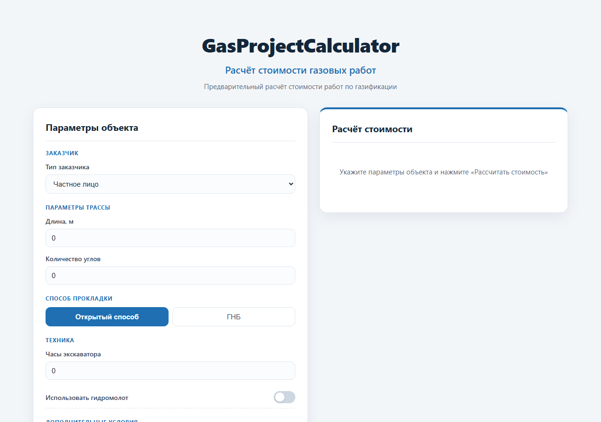
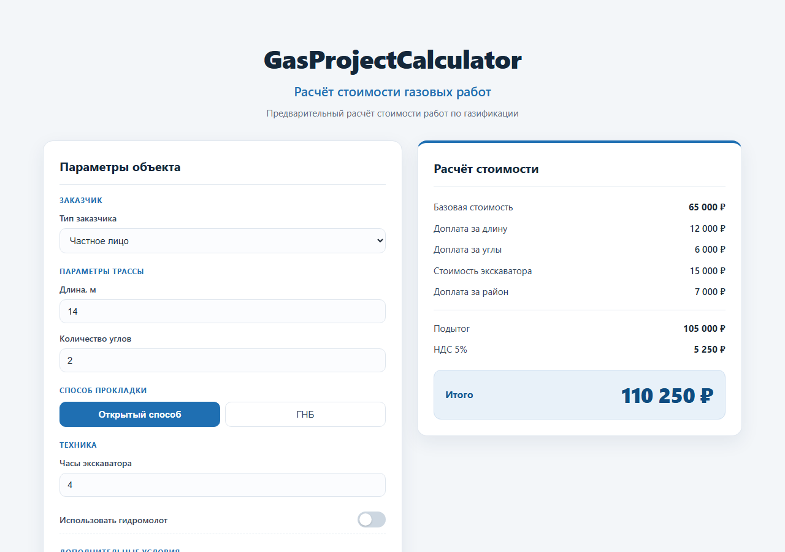

# GasProjectCalculator

Веб-калькулятор стоимости работ по газовым проектам: ГСН, ГСВ и общая смета
ГСН + ГСВ. Вводишь параметры объекта — получаешь расшифровку расчёта с НДС.

## Что умеет калькулятор

- Три режима: ГСН, ГСВ, ГСН + ГСВ (общая смета).
- Рассчитывает стоимость подключения газа для частного и юридического лица.
- ГСН учитывает: длину трассы, углы, экскаватор, ГНБ, район, ГРПШ.
- ГСВ учитывает: длину, диаметр, алмазное бурение, комплекты САКЗ, ПК и район.
- Показывает расшифровку: базовая стоимость, каждая доплата отдельно, подытог,
  НДС 5% и итог; в общем режиме — оба раздела и общий итог.
- Валидирует входные данные на сервере (HTTP 422 при некорректных значениях),
  включая ПК без САКЗ и диаметр больше 57 мм.
- Работает в браузере: HTML-форма → JavaScript → FastAPI
  (`POST /calculate`, `POST /calculate/gsv`, `POST /calculate/combined`).

## Интерфейс

### Форма расчёта



### Результат расчёта



## Технологии

- Python
- FastAPI
- Pydantic
- HTML / CSS / JavaScript
- unittest (для тестов)

## Бизнес-правила GSN v1.0

- Частник: базовая стоимость **65 000 ₽** до 10 м.
- Юрлицо: базовая стоимость **85 000 ₽** до 10 м.
- Каждый метр сверх 10 м: **+3 000 ₽**.
- Угол: **+3 000 ₽** за каждый.
- ГНБ: **+40 000 ₽**.
- При ГНБ экскаватор **не рассчитывается**.
- Экскаватор: согласно существующим правилам (до 2 ч — 9 000 ₽ / 10 000 ₽ с молотом, далее 3 000 ₽ / 3 500 ₽ за час).
- Район: **+7 000 ₽**.
- ГРПШ: **+40 000 ₽**.
- НДС: **5%** от подытога, в конце.

## Бизнес-правила ГСВ

- База за длину до 5 м включительно: частник **60 000 ₽**, юрлицо **80 000 ₽**.
- Каждый метр сверх 5 м: диаметр до 25 мм — **2 500 ₽**, 26–40 мм — **3 500 ₽**,
  41–57 мм — **4 000 ₽**. Диаметр больше 57 мм отклоняется.
- Алмазное бурение: без услуги **0 ₽**, за 1–2 отверстия **8 000 ₽**,
  за 3 и более — **10 000 ₽**.
- САКЗ: количество комплектов × **14 000 ₽**.
- ПК: **4 000 ₽**, доступен только при наличии хотя бы одного комплекта САКЗ;
  ПК без САКЗ отклоняется сервером (422) и блокируется/сбрасывается в интерфейсе.
- Район: **+7 000 ₽** к каждому разделу; в общей смете — **+14 000 ₽** до НДС.
- НДС: **5%** после сложения базы и всех доплат.

## Структура проекта

```
GasProjectCalculator/
├── app/
│   ├── main.py            # FastAPI: GET /, POST /calculate, /calculate/gsv, /calculate/combined
│   ├── calculator.py      # Бизнес-логика ГСН
│   └── gsv_calculator.py  # Изолированная бизнес-логика ГСВ
├── frontend/
│   └── index.html         # Интерфейс трёх режимов
├── tests/
│   ├── test_calculator.py     # Модульные тесты ГСН
│   ├── test_main.py           # API-тесты ГСН
│   ├── test_gsv_calculator.py # Модульные тесты ГСВ
│   └── test_gsv_api.py        # API-тесты ГСВ и общей сметы
└── requirements.txt
```

## Как установить зависимости

```powershell
python -m venv .venv
.\.venv\Scripts\python.exe -m pip install -r requirements.txt
```

## Как запустить сервер

```powershell
.\.venv\Scripts\python.exe -m uvicorn app.main:app --reload
```

## Где открыть приложение

После запуска сервера откройте в браузере:

```
http://127.0.0.1:8000/
```

## Как запустить тесты

```powershell
.\.venv\Scripts\python.exe -m unittest discover -s tests
```

## Текущий результат тестов

- **131 тест, 131 проходит (OK).** Прежние 57 тестов ГСН сохранены.

## Пример расчёта

Частник, длина 14 м, 2 угла, 4 часа экскаватора без гидромолота, объект в районе, без ГНБ и ГРПШ:

- Базовая стоимость: 65 000 ₽
- Доплата за длину: 12 000 ₽
- Доплата за углы: 6 000 ₽
- Стоимость экскаватора: 15 000 ₽
- Доплата за район: 7 000 ₽
- Подытог: 105 000 ₽
- НДС (5%): 5 250 ₽
- **Итого: 110 250 ₽**

## Пример расчёта ГСВ

Частник, 8 м, Ø25, 2 отверстия, 1 комплект САКЗ, ПК, объект в районе:

- Базовая стоимость: 60 000 ₽
- Доплата за длину (3 м × 2 500): 7 500 ₽
- Бурение: 8 000 ₽
- САКЗ: 14 000 ₽
- ПК: 4 000 ₽
- Район: 7 000 ₽
- Подытог: 100 500 ₽
- НДС (5%): 5 025 ₽
- **Итого: 105 525 ₽**

## Ограничения версии

- Диаметр ГСВ больше 57 мм не поддерживается и отклоняется.
- ПК недоступен без САКЗ; количество ПК — один.
- Нижние примечания прайса и строка «Проект» в scope не входят.
- Учёт пользователей, БД, экспорт и deployment не реализованы.