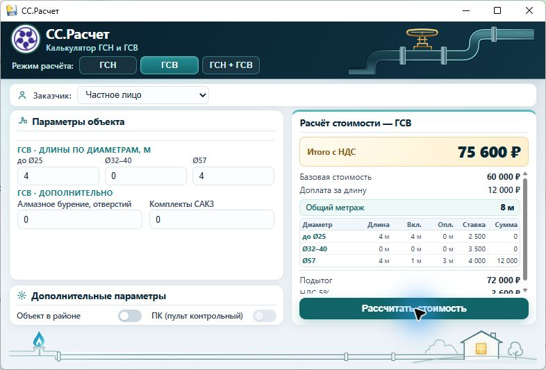
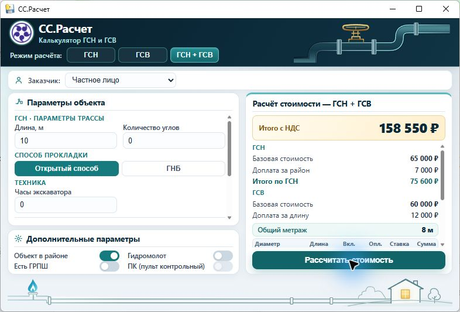
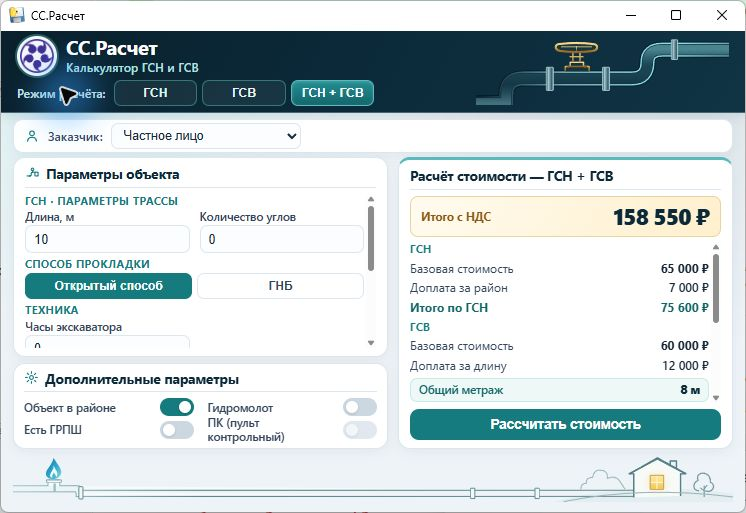
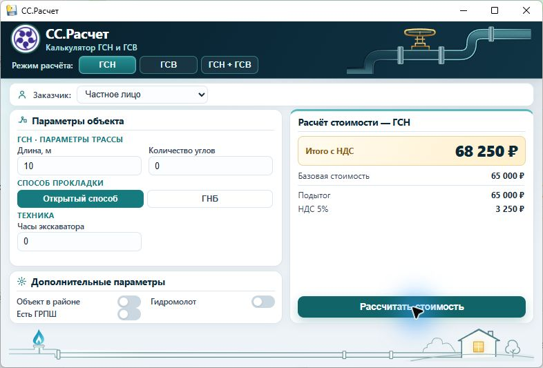
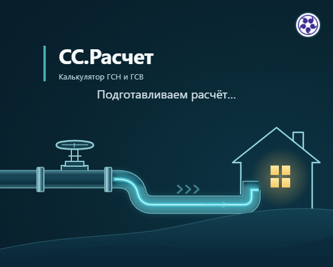
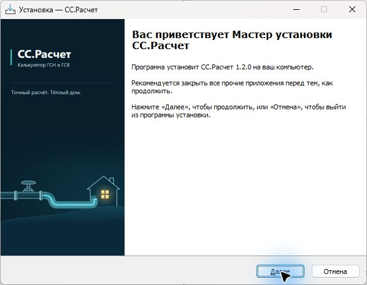
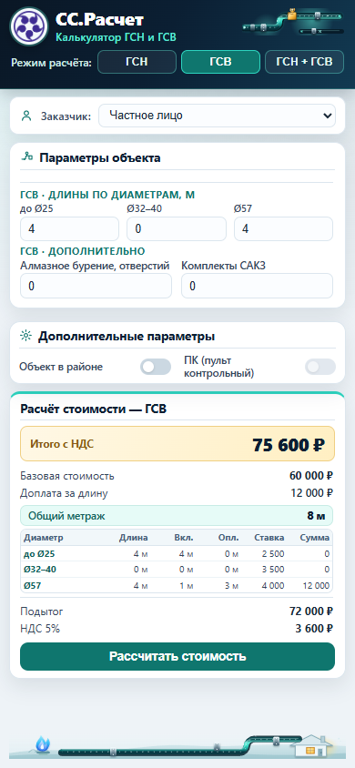
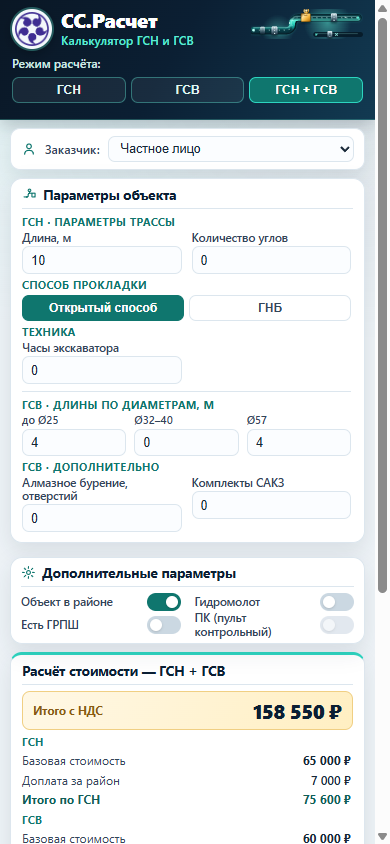

<div align="center">


# СС.Расчет

**Калькулятор стоимости газификации для ООО «Северное сияние»**

ГСН · ГСВ · Общая смета — в компактном приложении Windows

[](https://github.com/shahove93/GasProjectCalculator/releases/latest/download/SS-Raschet-Setup.exe)

[Опубликованный выпуск](https://github.com/shahove93/GasProjectCalculator/releases/latest) · [Сайт компании](https://nordgas11.ru/)



</div>

## Что умеет приложение

- Отдельные расчёты **ГСН**, **ГСВ** и **общий итог ГСН + ГСВ**.
- В ГСВ — три независимые длины труб: **до Ø25**, **Ø32–40** и **Ø57**; общий метраж и детализация по каждой позиции.
- Тарифы для частных и юридических лиц, доплаты за работы и оборудование.
- Расшифровка каждой суммы, подытог, **НДС 5%** и итоговая стоимость.
- Комплекты САКЗ и пульт контрольный; ПК доступен только при наличии САКЗ.
- Компактное окно **800×540**, фирменная эмблема и анимированная заставка.
- Русский интерфейс и русский мастер установки.

## Скачать и установить

Последняя версия **1.2.0** — визуальная доработка: новая шапка и нижняя полоса,
обновлённая заставка и установщик в едином фирменном стиле. Расчёты не менялись.
**[Скачать установщик Windows](https://github.com/shahove93/GasProjectCalculator/releases/latest/download/SS-Raschet-Setup.exe)**.

| Параметр | Значение |
| --- | --- |
| Файл | `SS-Raschet-Setup.exe` |
| Размер | 15 373 267 байт |
| ProductVersion | 1.2.0 |
| SHA256 | `4579FB3AA7B2E6220C1204E3AA2A6048648AE5A344B8E2D45DD00CF19F856113` |

Итог и проверки: `docs/workflow/FINAL-REPORT-VISUAL-POLISH.md`.
Предыдущие выпуски 1.0.0 и 1.1.0 сохранены отдельно, их файлы не заменялись.

1. Скачайте и запустите `SS-Raschet-Setup.exe`, пройдите русский мастер установки. Права администратора не требуются.
2. По желанию выберите ярлык на рабочем столе. В меню **Пуск** ярлык создаётся автоматически.
3. Откройте **СС.Расчет**. Устанавливать Python и выполнять команды не нужно.

Приложение предназначено для **Windows x64**. Для окна приложения требуется **Microsoft Edge WebView2 Runtime**. После установки калькулятор выполняет расчёты локально, без подключения к серверу компании.

Установщик 1.2.0 не имеет цифровой подписи, поэтому Windows SmartScreen может показать предупреждение. Целостность файла можно проверить по указанному выше SHA256 и файлу `SHA256SUMS.txt` на странице выпуска.

**Обновление:** закройте приложение и запустите новый установщик. **Удаление:** Параметры Windows → Приложения → СС.Расчет → Удалить. Пользовательские файлы в Documents, на рабочем столе и журналы приложения в `%LOCALAPPDATA%\GasProjectCalculator` при удалении сохраняются.

## Как это выглядит

### Расчёт ГСВ


### Общая смета



<details>
<summary>Детализация, расчёт ГСН, заставка и мастер установки</summary>









</details>

<details>
<summary>Мобильная вёрстка в браузере, 390×844</summary>





</details>

## Тарифы и правила расчёта

### ГСН

| Позиция | Стоимость |
| --- | ---: |
| База до 10 м — частное лицо | 65 000 ₽ |
| База до 10 м — юридическое лицо | 85 000 ₽ |
| Метр сверх 10 м | 3 000 ₽ |
| Каждый угол | 3 000 ₽ |
| ГНБ | 40 000 ₽ |
| ГРПШ | 40 000 ₽ |
| Объект в районе | 7 000 ₽ |

Экскаватор: до 2 часов — 9 000 ₽, с гидромолотом — 10 000 ₽; каждый последующий час — 3 000 ₽ или 3 500 ₽ соответственно. При нулевом количестве часов доплаты нет. При ГНБ экскаватор отдельно не рассчитывается.

### ГСВ

| Позиция | Стоимость |
| --- | ---: |
| База до 5 м — частное лицо | 60 000 ₽ |
| База до 5 м — юридическое лицо | 80 000 ₽ |
| Метр сверх 5 м — до Ø25 | 2 500 ₽ |
| Метр сверх 5 м — Ø32–40 | 3 500 ₽ |
| Метр сверх 5 м — Ø57 | 4 000 ₽ |
| Алмазное бурение, 1–2 отверстия | 8 000 ₽ |
| Алмазное бурение, 3 и более отверстий | 10 000 ₽ |
| Комплект САКЗ (2 датчика) | 14 000 ₽ |
| ПК — один дополнительный пульт | 4 000 ₽ |
| Объект в районе | 7 000 ₽ |

Вводятся три независимые длины: **до Ø25**, **Ø32–40** и **Ø57**; общий метраж — их сумма. Базовая стоимость применяется один раз на раздел ГСВ. Пять базовых метров списываются с самых дешёвых труб первыми — **до Ø25 → Ø32–40 → Ø57**; оплачиваются только метры сверх этой базы по тарифу своей категории. Если суммарная длина не больше 5 м, доплата за метраж равна нулю. Если все три длины равны нулю, начисляется только базовая стоимость.

При отсутствии бурения доплата равна нулю. Комплектов САКЗ может быть несколько; ПК доступен только при наличии хотя бы одного комплекта. Диаметры свыше 57 мм не рассчитываются.

Эталонные примеры для частного лица в городе без дополнительных опций:

| до Ø25 / Ø32–40 / Ø57, м | Длина | Доплата | Подытог | Итог с НДС 5% |
| --- | ---: | ---: | ---: | ---: |
| 4 / 0 / 4 | 8 | 12 000 ₽ | 72 000 ₽ | 75 600 ₽ |
| 2 / 4 / 3 | 9 | 15 500 ₽ | 75 500 ₽ | 79 275 ₽ |
| 0 / 5 / 2 | 7 | 8 000 ₽ | 68 000 ₽ | 71 400 ₽ |
| 3 / 1 / 1 | 5 | 0 ₽ | 60 000 ₽ | 63 000 ₽ |
| 8 / 0 / 0 | 8 | 7 500 ₽ | 67 500 ₽ | 70 875 ₽ |

**НДС 5%** добавляется после всех доплат. В общей смете район учитывается в каждом разделе: **14 000 ₽ до НДС** за ГСН и ГСВ вместе. Пример общей сметы для частного лица с объектом в районе: ГСН 10 м без прочих опций — 75 600 ₽ с НДС; ГСВ 4/0/4 без прочих опций — 82 950 ₽ с НДС; общий подытог 151 000 ₽, НДС 7 550 ₽, итог **158 550 ₽**.

## Для разработчика

Стек: Python, FastAPI, Pydantic, HTML/CSS/JavaScript; desktop — pywebview и PyInstaller, установщик — Inno Setup.

Из папки проекта в PowerShell:

```powershell
python -m venv .venv
.\.venv\Scripts\python.exe -m pip install -r requirements.txt
.\.venv\Scripts\python.exe -m uvicorn app.main:app --reload
```

Откройте <http://127.0.0.1:8000/>. Установленная desktop-версия использует локальный backend, который автоматически запускается и останавливается вместе с окном.

```powershell
.\.venv\Scripts\python.exe -m unittest discover -s tests
```

Сборка desktop: [packaging/README.md](packaging/README.md). Сборка установщика: [installer/build-installer.ps1](installer/build-installer.ps1).

Текущая сборка — **1.2.0**. Unit suite: **219 тестов — OK**. Установленная 1.2.0 проверена в одной среде Windows x64/WebView2, DPI 96. Доказательства: [MD-01](docs/workflow/evidence/MD-01-evidence.md), [MD-02](docs/workflow/evidence/MD-02-evidence.md), [MD-03](docs/workflow/evidence/MD-03-evidence.md).
