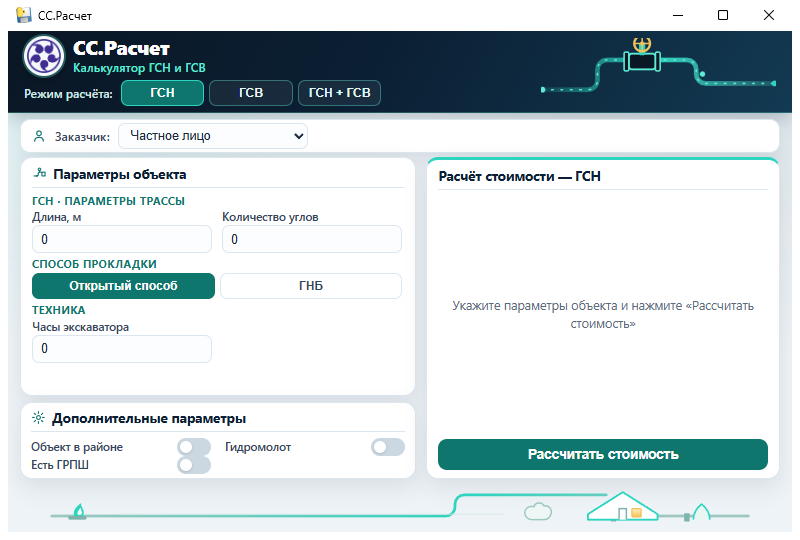
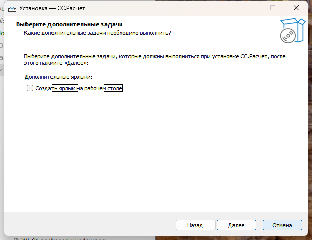
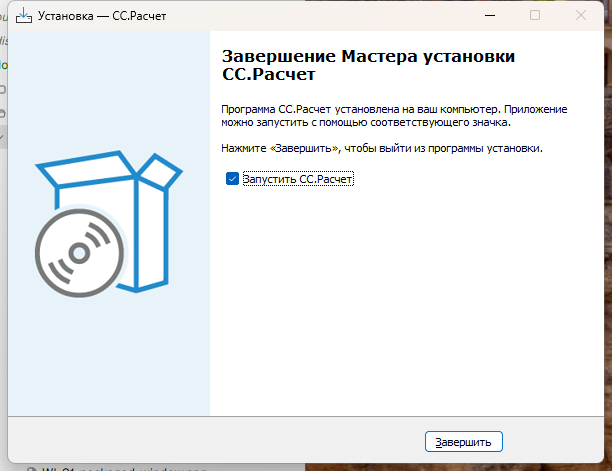
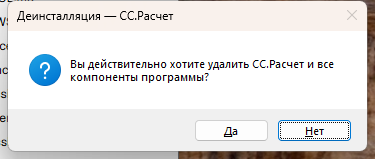
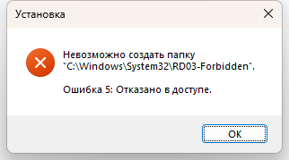

# СС.Расчет

**Калькулятор ГСН и ГСВ**

Веб-калькулятор стоимости работ по газовым проектам: ГСН, ГСВ и общая смета
ГСН + ГСВ. Вводишь параметры объекта — получаешь расшифровку расчёта с НДС.

## Установка на Windows

Для обычного пользователя готовый установщик уже собран локально: **Python,
командная строка и консоль не нужны**.

1. Откройте установщик:
   `D:\Antigravity\GasProjectCalculator\installer\Output\GasProjectCalculator-Setup-1.0.0.exe`
   (размер **15 286 980 байт**, SHA256
   `71232EE4E5A4656D3375EE95758F77038912FABC44F8658396D7E60752BA7E08`).
   Предыдущий проверенный установщик сохранён в
   `installer/Output/legacy/GasProjectCalculator-Setup-1.0.0-pre-compact.exe`.
2. Запустите его и пройдите русский мастер установки. Установка выполняется
   только для текущего пользователя (per-user), в каталог
   `%LOCALAPPDATA%\Programs\GasProjectCalculator`; права администратора не
   требуются.
3. После установки в меню **Пуск** всегда появляется ярлык **СС.Расчет**. Ярлык
   на рабочем столе создаётся только при выборе необязательного пункта в
   мастере (по умолчанию пункт снят).
4. Запустите приложение ярлыком **СС.Расчет**. Приложение открывается в
   собственном окне с заголовком **СС.Расчет**; издатель в свойствах —
   `ООО «Северное сияние»`.

Установщик — **локальная неподписанная сборка**: кодовая подпись не
выполнялась, поэтому Windows SmartScreen может показать предупреждение при
первом запуске. Это ожидаемо.

Бэкенд слушает только localhost (`127.0.0.1`) и наружу ничего не публикует;
другие компьютеры в сети к нему не подключаются. Закрытие окна останавливает
приложение и освобождает порт. Файлы пользователя (журнал приложения) пишутся
в `%LOCALAPPDATA%\GasProjectCalculator`, а не в каталог установки, поэтому
удаление программы их не затрагивает.

### Удаление

Параметры Windows → Приложения → Установленные приложения →
**СС.Расчет** → **Удалить**. Удаление идёт через русский мастер удаления:
удаляются файлы программы и ярлыки (меню «Пуск» и рабочий стол), а
пользовательские файлы в `%LOCALAPPDATA%\GasProjectCalculator` сохраняются.

### Доказательства

Установка, запуск без Python, ярлыки, работа трёх режимов, остановка при
закрытии окна и удаление проверены на этой машине. Подробные отчёты с командами
и журналами: [WI-01](docs/workflow/evidence/WI-01-evidence.md),
[WI-02](docs/workflow/evidence/WI-02-evidence.md),
[WI-03](docs/workflow/evidence/WI-03-evidence.md). Редизайн бренда, окна,
заставки и установщика задокументирован в evidence и ревью:
[RD-01](docs/workflow/evidence/RD-01-evidence.md),
[RD-02](docs/workflow/evidence/RD-02-evidence.md),
[RD-03](docs/workflow/evidence/RD-03-evidence.md). Компактная корректировка
окна/вёрстки и пересобранный установщик — [RD-05](docs/workflow/evidence/RD-05-evidence.md),
[RD-06](docs/workflow/evidence/RD-06-evidence.md); ревью — в
[`docs/workflow/reviews/`](docs/workflow/reviews/)
([RD-01](docs/workflow/reviews/RD-01-review.md),
[RD-02](docs/workflow/reviews/RD-02-review.md),
[RD-03](docs/workflow/reviews/RD-03-review.md),
[RD-05](docs/workflow/reviews/RD-05-review.md),
[RD-06](docs/workflow/reviews/RD-06-review.md)).

## Что изменилось в редизайне

- **Бренд.** Продукт называется `СС.Расчет` с подписью `Калькулятор ГСН и
  ГСВ`; используется круглая эмблема компании (`ООО «Северное сияние»`).
- **Окно.** Компактное окно приложения **800×540** пикселей (минимальный
  размер **760×520**), с плотной вёрсткой по утверждённому макету: шапка с
  эмблемой и трубой/вентилем, переключатель режимов, строка заказчика, пары
  полей, отдельный блок опций, результат справа с итогом. Текст остаётся
  читаемым без масштабирования; кнопка расчёта и итог доступны без прокрутки
  всей страницы. Все три режима, поля, значения и расчёты сохранены.
- **Заставка запуска.** Локальная русская заставка 520×320 с анимацией потока
  газа по трубе к дому показывается только пока стартует backend; после
  готовности backend заставка закрывается и появляется главное окно.
  Настройка ОС `prefers-reduced-motion` уважается — при уменьшении движения
  анимация отключается.
- **Установщик и удаление.** Мастер установки и мастер удаления — на русском
  языке; ярлык и заголовок окна — `СС.Расчет`; издатель —
  `ООО «Северное сияние»`.

Расчёты, бизнес-правила, API и структура проекта при редизайне **не
менялись** (см. разделы ниже). Визуальная часть и installer изменились
отдельным этапом; исходный код расчётов и тесты остались прежними.

## Что умеет калькулятор

- Три режима: ГСН, ГСВ, ГСН + ГСВ (общая смета).
- Рассчитывает стоимость подключения газа для частного и юридического лица.
- ГСН учитывает: длину трассы, углы, экскаватор, ГНБ, район, ГРПШ.
- ГСВ учитывает: длину, диаметр, алмазное бурение, комплекты САКЗ, ПК и район.
- Показывает расшифровку: базовая стоимость, каждая доплата отдельно, подытог,
  НДС 5% и итог; в общем режиме — оба раздела и общий итог.
- Валидирует входные данные на сервере (HTTP 422 при некорректных значениях),
  включая ПК без САКЗ и диаметр больше 57 мм.
- Интерфейс: HTML-форма → JavaScript → FastAPI
  (`POST /calculate`, `POST /calculate/gsv`, `POST /calculate/combined`);
  открывается в окне приложения, а при запуске из исходников — в браузере.

## Интерфейс

### Форма расчёта и результаты


ГСН:


ГСВ:


Общая смета ГСН + ГСВ:


Мобильный вид (390×844):
[viewport](docs/screenshots/rd-06-installed-mobile-390x844.png).

### Заставка запуска и главное окно




### Установщик











## Технологии

- Python
- FastAPI
- Pydantic
- HTML / CSS / JavaScript
- unittest (для тестов)

## Бизнес-правила GSN v1.0

- Частник: базовая стоимость **65 000 ₽** до 10 м.
- Юрлицо: базовая стоимость **85 000 ₽** до 10 м.
- Каждый метр сверх 10 м: **+3 000 ₽**.
- Угол: **+3 000 ₽** за каждый.
- ГНБ: **+40 000 ₽**.
- При ГНБ экскаватор **не рассчитывается**.
- Экскаватор: согласно существующим правилам (до 2 ч — 9 000 ₽ / 10 000 ₽ с молотом, далее 3 000 ₽ / 3 500 ₽ за час).
- Район: **+7 000 ₽**.
- ГРПШ: **+40 000 ₽**.
- НДС: **5%** от подытога, в конце.

## Бизнес-правила ГСВ

- База за длину до 5 м включительно: частник **60 000 ₽**, юрлицо **80 000 ₽**.
- Каждый метр сверх 5 м: диаметр до 25 мм — **2 500 ₽**, 26–40 мм — **3 500 ₽**,
  41–57 мм — **4 000 ₽**. Диаметр больше 57 мм отклоняется.
- Алмазное бурение: без услуги **0 ₽**, за 1–2 отверстия **8 000 ₽**,
  за 3 и более — **10 000 ₽**.
- САКЗ: количество комплектов × **14 000 ₽**.
- ПК: **4 000 ₽**, доступен только при наличии хотя бы одного комплекта САКЗ;
  ПК без САКЗ отклоняется сервером (422) и блокируется/сбрасывается в интерфейсе.
- Район: **+7 000 ₽** к каждому разделу; в общей смете — **+14 000 ₽** до НДС.
- НДС: **5%** после сложения базы и всех доплат.

## Структура проекта

```
GasProjectCalculator/
├── app/
│   ├── main.py            # FastAPI: GET /, POST /calculate, /calculate/gsv, /calculate/combined
│   ├── calculator.py      # Бизнес-логика ГСН
│   └── gsv_calculator.py  # Изолированная бизнес-логика ГСВ
├── frontend/
│   └── index.html         # Интерфейс трёх режимов
├── tests/
│   ├── test_calculator.py     # Модульные тесты ГСН
│   ├── test_main.py           # API-тесты ГСН
│   ├── test_gsv_calculator.py # Модульные тесты ГСВ
│   └── test_gsv_api.py        # API-тесты ГСВ и общей сметы
└── requirements.txt
```

## Для разработчика (запуск из исходного кода)

Разделы ниже нужны только для работы с исходным кодом. Обычному пользователю
достаточно установщика из раздела «Установка на Windows». Developer-путь
(uvicorn и тесты) редизайном не менялся.

### Установка зависимостей

```powershell
python -m venv .venv
.\.venv\Scripts\python.exe -m pip install -r requirements.txt
```

### Запуск сервера

```powershell
.\.venv\Scripts\python.exe -m uvicorn app.main:app --reload
```

### Где открыть приложение

После запуска сервера откройте в браузере:

```
http://127.0.0.1:8000/
```

### Тесты

```powershell
.\.venv\Scripts\python.exe -m unittest discover -s tests
```

### Запуск из исходного кода на другом компьютере

Эта инструкция — только для запуска из исходного кода. Обычному пользователю
нужен установщик из раздела «Установка на Windows».

1. Установите Python 3.10 или новее с сайта [python.org](https://www.python.org/downloads/windows/).
   В установщике включите **Add Python to PATH**.
2. На [странице ветки feature/gsv в GitHub](https://github.com/shahove93/GasProjectCalculator/tree/feature/gsv)
   нажмите **Code → Download ZIP**, затем распакуйте архив.
3. Откройте PowerShell в распакованной папке проекта и выполните:

```powershell
python -m venv .venv
.\.venv\Scripts\python.exe -m pip install -r requirements.txt
.\.venv\Scripts\python.exe -m uvicorn app.main:app
```

4. Откройте <http://127.0.0.1:8000/> в браузере. Чтобы остановить сервер,
   нажмите `Ctrl+C` в PowerShell.

## Устранение неполадок и данные пользователя

- Приложение не запускается и показывает окно с ошибкой: чаще всего не
  установлен компонент **Microsoft Edge WebView2 Runtime** (входит в актуальные
  версии Windows) либо антивирус блокирует запуск. Текст причины и путь к
  журналу показываются в самом диалоге.
- Журнал приложения: `%LOCALAPPDATA%\GasProjectCalculator\logs\desktop.log`.
- Бэкенд работает только локально: порт выбирается начиная с 8000, занятые
  порты пропускаются, прослушивается только `127.0.0.1`. Другие компьютеры в
  сети к приложению не подключаются.
- Каталог установки — `%LOCALAPPDATA%\Programs\GasProjectCalculator`. Файлы
  пользователя и журналы хранятся вне его (в
  `%LOCALAPPDATA%\GasProjectCalculator`) и при удалении программы сохраняются.

## Пример расчёта

Частник, длина 14 м, 2 угла, 4 часа экскаватора без гидромолота, объект в районе, без ГНБ и ГРПШ:

- Базовая стоимость: 65 000 ₽
- Доплата за длину: 12 000 ₽
- Доплата за углы: 6 000 ₽
- Стоимость экскаватора: 15 000 ₽
- Доплата за район: 7 000 ₽
- Подытог: 105 000 ₽
- НДС (5%): 5 250 ₽
- **Итого: 110 250 ₽**

## Пример расчёта ГСВ

Частник, 8 м, Ø25, 2 отверстия, 1 комплект САКЗ, ПК, объект в районе:

- Базовая стоимость: 60 000 ₽
- Доплата за длину (3 м × 2 500): 7 500 ₽
- Бурение: 8 000 ₽
- САКЗ: 14 000 ₽
- ПК: 4 000 ₽
- Район: 7 000 ₽
- Подытог: 100 500 ₽
- НДС (5%): 5 025 ₽
- **Итого: 105 525 ₽**
