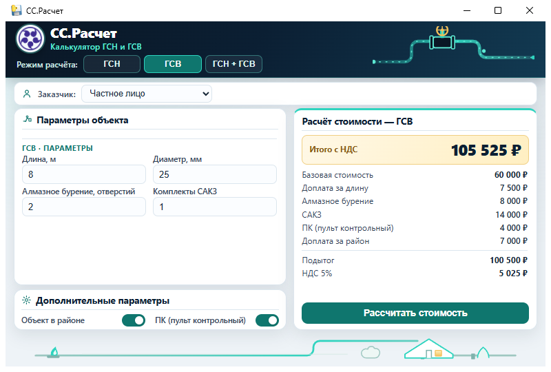
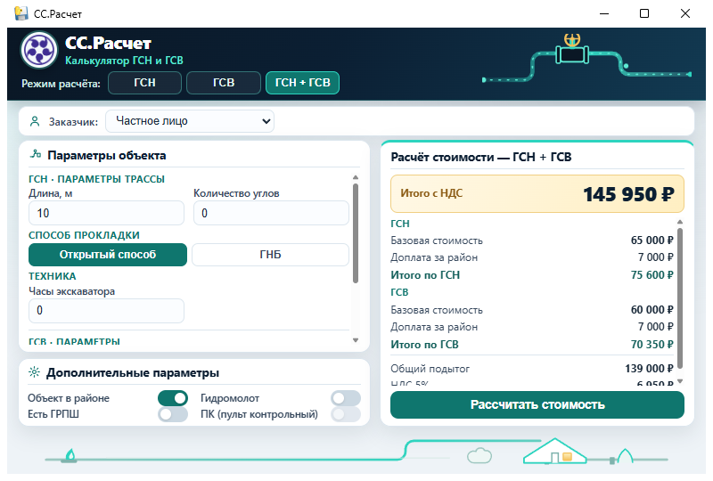
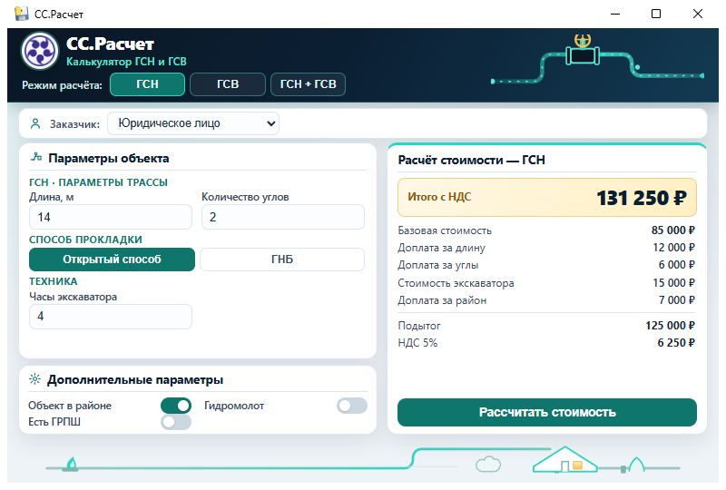
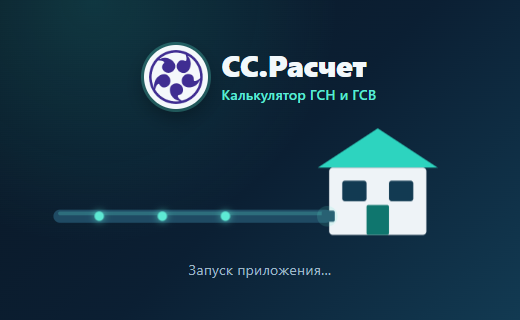
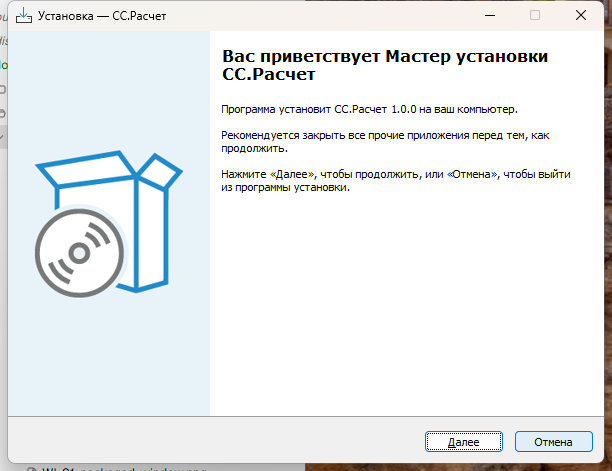

<div align="center">


# СС.Расчет

**Калькулятор стоимости газификации для ООО «Северное сияние»**

ГСН · ГСВ · Общая смета — в компактном приложении Windows

[](https://github.com/shahove93/GasProjectCalculator/releases/latest/download/SS-Raschet-Setup.exe)

[Последний выпуск](https://github.com/shahove93/GasProjectCalculator/releases/latest) · [Сайт компании](https://nordgas11.ru/)



</div>

## Что умеет приложение

- Отдельные расчёты **ГСН**, **ГСВ** и **общий итог ГСН + ГСВ**.
- Тарифы для частных и юридических лиц, доплаты за работы и оборудование.
- Расшифровка каждой суммы, подытог, **НДС 5%** и итоговая стоимость.
- Комплекты САКЗ и пульт контрольный; ПК доступен при наличии САКЗ.
- Компактное окно **800×540**, фирменная эмблема и анимированная заставка.
- Русский интерфейс и русский мастер установки.

## Скачать и установить

1. **[Скачайте установщик Windows](https://github.com/shahove93/GasProjectCalculator/releases/latest/download/SS-Raschet-Setup.exe)** на нужном компьютере.
2. Запустите `SS-Raschet-Setup.exe` и пройдите мастер установки. Права администратора не требуются.
3. По желанию выберите ярлык на рабочем столе. В меню **Пуск** ярлык создаётся автоматически.
4. Откройте **СС.Расчет**. Устанавливать Python и выполнять команды не нужно.

Приложение предназначено для **Windows x64**. Для окна приложения требуется **Microsoft Edge WebView2 Runtime**. После установки калькулятор выполняет расчёты локально, без подключения к серверу компании.

Установщик не имеет цифровой подписи, поэтому Windows SmartScreen может показать предупреждение. Сверить файл можно по `SHA256SUMS.txt` на [странице выпуска](https://github.com/shahove93/GasProjectCalculator/releases/latest).

**Обновление:** закройте приложение и запустите новый установщик. **Удаление:** Параметры Windows → Приложения → СС.Расчет → Удалить. Журналы приложения в `%LOCALAPPDATA%\GasProjectCalculator` сохраняются.

## Как это выглядит

### Общая смета



<details>
<summary>Расчёт ГСН, заставка и мастер установки</summary>







</details>

## Тарифы и правила расчёта

### ГСН

| Позиция | Стоимость |
| --- | ---: |
| База до 10 м — частное лицо | 65 000 ₽ |
| База до 10 м — юридическое лицо | 85 000 ₽ |
| Метр сверх 10 м | 3 000 ₽ |
| Каждый угол | 3 000 ₽ |
| ГНБ | 40 000 ₽ |
| ГРПШ | 40 000 ₽ |
| Объект в районе | 7 000 ₽ |

Экскаватор: до 2 часов — 9 000 ₽, с гидромолотом — 10 000 ₽; каждый последующий час — 3 000 ₽ или 3 500 ₽ соответственно. При нулевом количестве часов доплаты нет. При ГНБ экскаватор отдельно не рассчитывается.

### ГСВ

| Позиция | Стоимость |
| --- | ---: |
| База до 5 м — частное лицо | 60 000 ₽ |
| База до 5 м — юридическое лицо | 80 000 ₽ |
| Метр сверх 5 м, диаметр до 25 мм | 2 500 ₽ |
| Метр сверх 5 м, диаметр 26–40 мм | 3 500 ₽ |
| Метр сверх 5 м, диаметр 41–57 мм | 4 000 ₽ |
| Алмазное бурение, 1–2 отверстия | 8 000 ₽ |
| Алмазное бурение, 3 и более отверстий | 10 000 ₽ |
| Комплект САКЗ (2 датчика) | 14 000 ₽ |
| ПК — один дополнительный пульт | 4 000 ₽ |
| Объект в районе | 7 000 ₽ |

При отсутствии бурения доплата равна нулю. Комплектов САКЗ может быть несколько; ПК доступен только при наличии хотя бы одного комплекта. Диаметры свыше 57 мм не рассчитываются.

**НДС 5%** добавляется после всех доплат. В общей смете район учитывается в каждом разделе: **14 000 ₽ до НДС** за ГСН и ГСВ вместе.

## Для разработчика

Стек: Python, FastAPI, Pydantic, HTML/CSS/JavaScript; desktop — pywebview и PyInstaller, установщик — Inno Setup.

Из папки проекта в PowerShell:

```powershell
python -m venv .venv
.\.venv\Scripts\python.exe -m pip install -r requirements.txt
.\.venv\Scripts\python.exe -m uvicorn app.main:app --reload
```

Откройте <http://127.0.0.1:8000/>. Установленная desktop-версия использует локальный backend, который автоматически запускается и останавливается вместе с окном.

```powershell
.\.venv\Scripts\python.exe -m unittest discover -s tests
```

Сборка desktop: [packaging/README.md](packaging/README.md). Сборка установщика: [installer/build-installer.ps1](installer/build-installer.ps1).

Последний принятый этап: **167 тестов — OK**, проверки установленного приложения и всех трёх режимов. Проверено в одной среде Windows x64/WebView2, DPI 96. [Итоговый отчёт и границы проверки](docs/workflow/FINAL-REPORT-COMPACT-CORRECTION.md).
